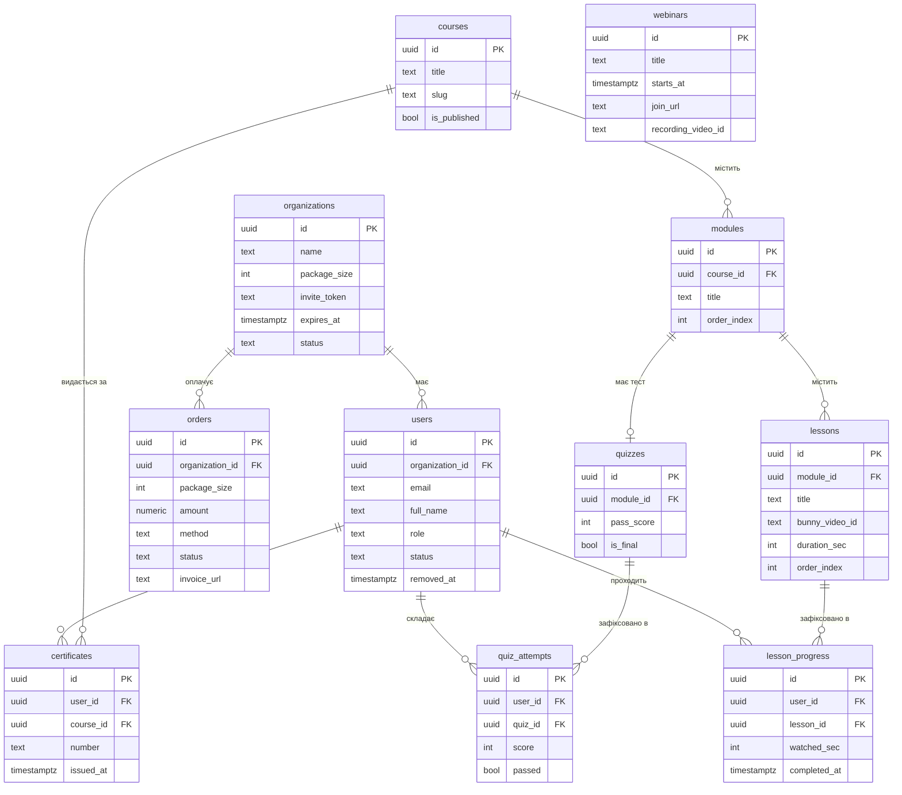
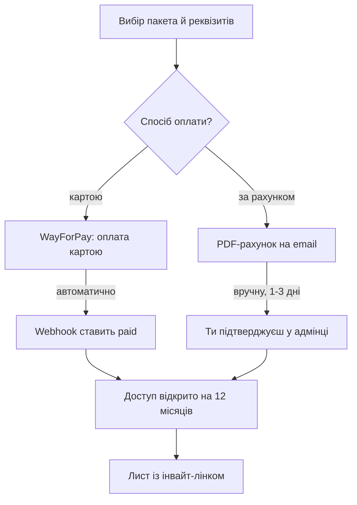
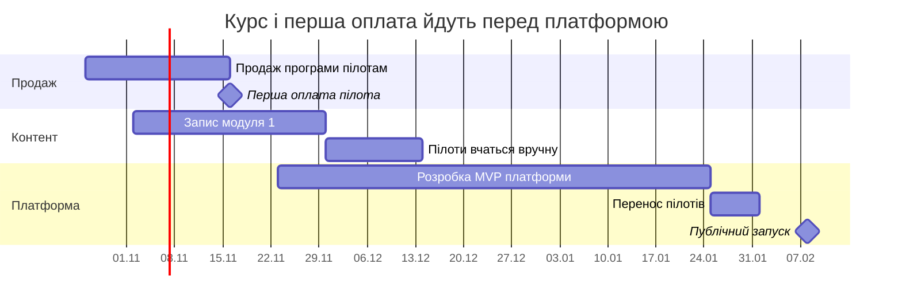

# PRD: Вражаючий сервіс

19 жовтня 2026 · Версія 1.0

**Вражаючий сервіс для ресторанів** — навчання персоналу, яке працює попри плинність кадрів.

## Огляд продукту

Ми будуємо не курс і не онбординг, а **систему, яка тримає рівень сервісу цілий рік**. Ввідний курс — це вхідний квиток: новачок проходить його з телефона за кілька змін і виходить у зал із базою. Далі починається те, за що заклад платить річну ціну: щомісячні вебінари з прийомами, які вирізняють заклад сервісом, архів їх записів, тести після модулів і звіт, у якому видно, хто з команди тримає планку, а хто просів.

**Проблема.** Ресторан втрачає гостей не тому, що офіціанти грубі, а тому що рівень сервісу тримається на пам'яті конкретних людей. Причин дві, і вони діють одночасно.

*Плинність* — 50–100% на рік. Новачок виходить у зал через два-три дні й переймає стандарт «на словах» від старших по зміні, тому з кожною передачею той деградує. Власник не має ні часу, ні системи, щоб кожен новачок виходив у зал із тим рівнем, який заклад собі обіцяв.

*Згасання* — офіціант, який працює рік, непомітно збивається на автопілот: вітання скорочується, рекомендація зникає, прощання проковтується. Навичка, яку ніхто не повторює й не перевіряє, тихо зникає з роботи, і це не видно доти, доки не почне падати середній чек.

Разом вони дають те, що бачить гість: візит у той самий заклад двічі лишає два різних враження. Повертається гість туди, де враження було сильнішим.

**Рішення.** Платформа закриває обидві причини — і саме тому доступ продається на рік, а не на курс.

- **Проти плинності** — місце в пакеті **перевикористовується**. Офіціант пішов, управляючий звільнив місце, воно перейшло наступному новачку. Заклад платить раз, а навчає всіх, хто пройде через зал за рік.
- **Проти згасання** — **щомісячний вебінар** на одну тему з конкретними прийомами, плюс запис для тих, хто був на зміні. Дванадцять точок за рік, у яких команда отримує те, чого вчора не вміла.
- **Для контролю** — звіт показує поіменно: хто пройшов курс, з яким балом склав тест, хто був на останніх вебінарах, хто не заходив тиждень. Власник бачить не «команда навчена», а хто саме й наскільки.

**Чому це продається.** Перше питання власника — «за що я плачу за рік, якщо ввідний курс проходиться за три дні?». Відповідь на нього має бути в першому ж екрані лендінга й у першій хвилині розмови, бо без неї річна ціна виглядає як переплата за відео.

За рік закладу на 25 осіб дістається: близько п'ятнадцяти навчених новачків замість п'ятнадцяти особистих інструктажів управляючого, дванадцять вебінарів, які не дають команді збитися на автопілот, і звіт, за яким рівень видно поіменно, а не відчувається. Ми продаємо повернутий час управляючого й сервіс, який гість запам'ятовує, — щозміни, а не тиждень після курсу.

**Цільовий результат першого року:** 10 платних ресторанів, у яких реально зайнято більше 60% куплених місць, команда яких ходить на вебінари після першого місяця, і які продовжують доступ на другий рік.

## Ринок і персони

Перший ринок — Україна. Ціль для MVP — **власник одного закладу**: він вирішує сам, не має процедур закупки й може купити самостійно за одну розмову. Мережі дають більший чек, але цикл продажу там місяці — це не перші клієнти.

### Хто купує

| Персона | Контекст | Шлях оплати | Пакет |
| --- | --- | --- | --- |
| Власник одного ресторану | 10–30 осіб персоналу, вирішує сам, без HR | Карта або рахунок на ФОП | 10–25 |
| Управляючий / керівник залу | Ініціює й потім користується, але бюджету не має | Просить власника | 10–25 |
| Опердиректор або HR мережі | 3–20 закладів, вимагає договір і звіти | Тільки рахунок, часто З ПДВ | 50+ |

У кабінеті цю роль називаємо **адміном ресторану**, не HR. Слово «HR» у одному закладі нічого не значить і відштовхує.

### Хто вчиться

Основна персона — **офіціант, 19–28 років**, перше або друге місце роботи, не впевнений, чи залишиться в закладі більше ніж на півроку. Хостес і бармен проходять той самий курс: гість не розрізняє посад, він виносить одне враження від закладу.

### Контекст використання — визначає весь дизайн

Це найважливіша частина розділу. Офіціант не сидить за столом із ноутбуком.

- **Пристрій:** телефон, часто Android середнього цінового сегмента, екран 360–400px
- **Місце:** підсобка, роздягальня, транспорт додому
- **Час:** 10–20 хвилин перед зміною або між змінами, ніколи не година поспіль
- **Інтернет:** Wi-Fi закладу (часто слабкий) або мобільний трафік, який він не хоче витрачати
- **Звук:** часто без навушників у гамірному приміщенні

**Прямі наслідки для продукту:** уроки по 3–7 хвилин, не по 40 · субтитри обов'язково · позиція у відео зберігається кожні 5 секунд · адаптивний бітрейт · дизайн проєктується під 375px **спершу**, а не «потім зробимо адаптив».

## Бізнес-модель

Разова покупка пакета місць із доступом на 12 місяців. Без автопродовження і без підписок.

| Пакет | Місць | Для кого | Ціна |
| --- | --- | --- | --- |
| Заклад | 10 | Кав'ярня, невеликий ресторан | $500 |
| Ресторан | 25 | Основний пакет, стандартний заклад | $1000 |
| Великий заклад | 50 | Великий ресторан або два заклади | $1500 |
| Мережа | 50+ | За запитом, через форму | індивідуально |

Ціна за одне місце падає з розміром пакета: $50, $40, $30 — тому великий заклад має прямий сенс брати пакет більше, ніж йому потрібно сьогодні. Орієнтир для розрахунку: порахуй, скільки годин управляючого йде зараз на навчання одного новачка, помнож на його ставку й на кількість новачків за рік. Ціна пакета має бути помітно нижчою за цю суму — це й є твій аргумент у продажі.

Ціни зафіксовані в доларах, але рахунок для української компанії виставляється в гривні — генератор рахунків мусить фіксувати курс на день виставлення.

### Що входить у пакет

Доступ до курсу на 12 місяців · N місць із правом перевикористання · **щомісячний вебінар і архів записів** · сертифікати · звіт для адміна ресторану.

Не входить: кастомний контент під заклад, приватні зустрічі, інші курси, брендинг.

### Вебінари — те, що перетворює курс на рік

Один вебінар на місяць, одна тема, конкретні прийоми. Відкритий для всіх закладів одразу — приватні зустрічі не масштабуються. Запис лягає в кабінет наступного дня, і для офіціанта, який був на зміні, він вартий не менше за живу участь.

**Це не бонус до курсу, а друга половина продукту.** Без вебінарів заклад платить за рік доступу до відео, яке подивився за три дні, — і на другий рік не продовжить. З ними доступ має сенс усі дванадцять місяців: щомісяця в команди з'являється прийом, якого вона вчора не знала.

Теми беруться не з базової ввічливості, а з того, що вирізняє заклад сервісом: як прочитати стіл за перші тридцять секунд, як рекомендувати так, щоб це звучало послугою, а не допродажем, як урятувати ситуацію із затриманою стравою, як запам'ятовувати постійних гостей. База — у ввідному курсі. На вебінарах — те, за чим гість повертається саме сюди.

**Навантаження на тебе.** Дванадцять вебінарів на рік — це один підготовлений виступ на місяць. Рідше не можна: квартальний ритм не тримає навичку й не виправдовує річну ціну. Частіше не треба: при двох на місяць команда перестане ходити на обидва.

### Перевикористання місць — відповідь на плинність

Адмін ресторану може звільнити місце, коли співробітник пішов. При цьому:

- доступ співробітника відкликається негайно;
- його прогрес, бали та сертифікат зберігаються в історії (для звітності й на випадок повернення);
- місце стає вільним і його може зайняти наступний новачок за тим самим лінком.

**Захист від зловживання.** Без ліміту мережа купить пакет на 10 місць і проведе крізь нього 200 людей. Пропоную м'який ліміт: сукупно не більше **3× розміру пакета унікальних користувачів за 12 місяців** (пакет на 25 → до 75 людей). Це з запасом покриває навіть плинність 100% і не заважає чесному клієнту. У MVP достатньо лічити цей ліміт і показувати в адмінці, без жорсткого блокування.

### Продовження

За 30 днів до кінця — лист адміну й банер у кабінеті. За 7 днів — повторно. Продовження — це нова покупка тим самим флоу, а не автосписання. Це свідомий компроміс: ми втрачаємо частину продовжень, але не будуємо біллінг підписок у MVP.

## Ключові рішення та їх обґрунтування

Усі ці рішення прийняті на етапі дисковері. Якщо потім захочеться щось змінити, диви на колонку «Чому так» — вона скаже, що саме зламається.

| Рішення | Альтернатива, яку відкинули | Чому так |
| --- | --- | --- |
| Один тенант, розділення через `organization_id` | Окремий простір і брендинг на клієнта | Ресторану на 20 осіб брендинг не потрібен. Економить 2–3 тижні. Міграція можлива потім |
| Self-serve **і** рахунок — оба у MVP | Тільки карта | Українська компанія не платить картою за навчання. Без рахунка втрачаємо більшість лідів на останньому кроці |
| Одне посилання-інвайт на весь заклад | Іменні інвайти по email | Офіціанти не мають корпоративної пошти. Управляючий кидає лінк у робочий чат — нуль тертя |
| Лінк обмежений кількістю місць і перегенеровується | Безстроковий лінк | Лінк у робочому чаті розійдеться. Без ліміту 25 місць з'їдять випадкові люди |
| Місце перевикористовується | Місце навічно за людиною | Головна цінність при плинності 50–100%. Без цього продукт ресторану не потрібен |
| 12 місяців доступу | Безстроково або підписка | Дає точку продовження без біллінгу підписок. Технічно — одне поле `expires_at` |
| Усім відкривається один курс | Призначення курсів по ролях | Платформа вчить сервісу в залі — це один курс для всіх, хто говорить із гостем. Модуль призначень не вирішує нічого |
| Щомісячний вебінар — частина продукту, а не маркетинг | Курс разово, вебінари для залучення | Курс проходиться за три дні, і без ритму річну ціну не виправдати. Вебінар — це те, за що платять з другого місяця по дванадцятий |
| Відвідування вебінарів видно у звіті | Тільки прогрес по курсу | Власник купує контроль, а не контент. Без цієї колонки він не знає, чи жива команда після першого тижня |
| Відкриті вебінари за розкладом | Приватні зустрічі на заклад | Приватні не масштабуються з self-serve — кожен клієнт з'їдав би твій час |
| Zoom-посилання для вебінарів | Вбудований стрім | Власний стрім — місяці роботи й нуль цінності поверх Zoom |
| Mobile-first | Desktop із адаптивом | Офіціант не має ноутбука. Це не про «зручність», а про те, буде курс пройдений чи ні |
| Урок зараховується автоматично на 90% відео | Ручний чекбокс «пройдено» | Звіт для власника має бути чесним. Ручний чекбокс робить його безглуздим |
| Magic link для входу співробітника | Email + пароль | Офіціант забуде пароль і більше не зайде. Supabase дає magic link із коробки |

## Функціональні вимоги MVP

Три ролі: **співробітник**, **адмін ресторану**, **суперадмін** (ти). Кожна вимога має критерій приймання — момент, коли можна сказати «готово».

### Співробітник

1. **Приєднання за лінком.** Переходить по інвайт-посиланню, вводить ім'я та email, отримує magic link на пошту.
   - *Приймання:* користувач прив'язаний до організації, місце списане, курс видно. Якщо місця закінчились — екран «місця закінчились, звернись до управляючого», а не помилка 500.
2. **Дашборд.** Одна головна кнопка «Продовжити», яка веде на перший незавершений урок, і прогрес «X із Y уроків».
3. **Плеєр уроку.** Відео, короткий опис, матеріали для завантаження, кнопка «Наступний».
   - *Приймання:* позиція зберігається кожні 5 секунд; після закриття браузера відео продовжується з того самого місця; урок зараховується автоматично на 90% прослуханого; субтитри доступні.
4. **Тест.** У кінці кожного модуля. Прохідний бал 80%, спроби необмежені, питання в рандомному порядку.
   - *Приймання:* після невдачі показує, які теми підтягнути, а не лише бал.
5. **Сертифікат.** PDF із ім'ям, назвою закладу, датою й унікальним номером після всіх модулів і фінального тесту.
6. **Вебінари.** Бачить найближчу дату, тему, кнопку «Приєднатись» і архів записів.
   - *Приймання:* найближчий вебінар видно на дашборді, а не лише в окремому розділі; запис з'являється в архіві не пізніше наступного дня після ефіру.

### Адмін ресторану

1. **Купівля пакета** — картою або за рахунком (деталі нижче, розділ «Оплата»).
2. **Інвайт-лінк** — бачить, копіює однією кнопкою, може перегенерувати.
   - *Приймання:* після перегенерації старий лінк не працює, а вже приєднані люди доступ зберігають.
3. **Список команди** — ім'я, email, дата приєднання, % пройдено, остання активність, бал фінального тесту, сертифікат, відвідані вебінари за останні три місяці.
   - *Приймання:* вебінар зараховується і за живу участь, і за перегляд запису — інакше колонка карає тих, хто був на зміні.
4. **Звільнення місця** — одна кнопка з підтвердженням.
   - *Приймання:* доступ зникає одразу, рядок переходить в історію зі збереженим прогресом, лічильник вільних місць +1.
5. **Експорт CSV** усього списку з прогресом.
6. **Стан пакета** — «зайнято 14 із 25», дата закінчення доступу, кнопка продовження.
7. **Документи** — історія оплат, завантаження рахунка, акта та квитанції.

### Суперадмін

1. **Конструктор курсу** — модулі й уроки з порядком, завантаження відео, описи, файли-матеріали.
2. **Редактор тестів** — питання, варіанти, правильні відповіді.
3. **Список організацій** — пакет, зайнято місць, статус оплати, `expires_at`, сукупна кількість користувачів за рік.
4. **Ручні дії** — підтвердити оплату рахунком, продовжити доступ, повернути кошти, додати місця.
5. **Вебінари** — створити (дата, тема, посилання), після — залити запис.
6. **Дашборд** — виручка, нові організації, активні учні, завершуваність.

### Нефункціональні вимоги

- **Ізоляція даних.** Жоден запит не може вернути дані іншої організації. Має бути покрите тестами до запуску — це єдине місце, де помилка коштує репутації.
- **Мобільна версія.** Усе, що бачить співробітник, тестується на реальном Android середнього сегмента, не лише в DevTools.
- **Швидкість.** Плеєр відкривається і починає грати за менше ніж 3 секунди на мобільному 4G.
- **Мова.** Українська. Без мультимовності в MVP.
- **Захист контенту.** Відео віддається тільки по підписаних URL із коротким терміном життя. Водяних знаків у MVP не робимо.

## Карта сторінок

У MVP — 20 сторінок. Теги: `MVP` — без цього немає продажу, `v1.1` — одразу після перших клієнтів.

### Публічна частина

| Сторінка | Що всередині | Тег |
| --- | --- | --- |
| Лендінг `/` | Заголовок про сервіс, який гість запам'ятовує · чому рівень просідає (плинність + згасання) · як працює у 3 кроки · **за що річна оплата** — ритм вебінарів · прийоми, яких вчимо · перевикористання місця · екрани продукту · чесний блок про етап · ціни · FAQ · заявка | `MVP` |
| Сторінка курсу `/course/[slug]` | Для кого · програма по модулях із тривалістью · що вмітиме офіціант після · про автора · демо-урок · вибір пакета · CTA | `MVP` |
| Ціни `/pricing` | Три пакети картками · що входить · пояснення про перевикористання місць · блок «більше 50 — напишіть нам» | `MVP` |
| Checkout `/checkout` | Кількість місць · назва закладу, ім'я, email · переключач **карта / рахунок** · для рахунка — реквізити · згода з офертою | `MVP` |
| Результат `/checkout/success` і `/fail` | Для карти — інвайт-лінк відразу на екрані · для рахунка — «рахунок на пошті, доступ після оплати» | `MVP` |
| Інвайт `/join/[token]` | Назва закладу · ім'я + email · кнопка входу · стани «місця закінчились» і «лінк недійсний» | `MVP` |
| Вхід `/login` | Email → magic link · окремий вхід із паролем для адміна ресторану | `MVP` |
| Оферта, Політика, Cookie | Юридичні тексти — обов'язкові для B2B і для платіжного провайдера | `MVP` |
| Сертифікат `/cert/[number]` | Публічна верифікація: ім'я, курс, дата | `v1.1` |
| Блог `/blog` | SEO-трафік по запитах про навчання персоналу | `v1.1` |

### Кабінет співробітника — проєктується під телефон

| Сторінка | Що всередині | Тег |
| --- | --- | --- |
| Дашборд `/learn` | Велика кнопка «Продовжити» · прогрес-бар · список модулів із галочками · найближчий вебінар | `MVP` |
| Урок `/learn/[lesson]` | Відео на всю ширину · назва й опис · матеріали · «Наступний урок» · позиція зберігається | `MVP` |
| Тест `/learn/[module]/quiz` | Одне питання на екран · прогрес «3 із 10» · результат із розбором помилок | `MVP` |
| Сертифікат `/learn/certificate` | Прев'ю і завантаження PDF | `MVP` |
| Вебінари `/learn/webinars` | Найближчий із кнопкою приєднання · архів записів | `MVP` |
| Профіль `/learn/profile` | Ім'я, email, вихід із акаунта | `MVP` |

### Кабінет адміна ресторану — те, за що платять

| Сторінка | Що всередині | Тег |
| --- | --- | --- |
| Дашборд `/admin` | Місць зайнято X із Y · середній % пройденого · «застрягли» — хто не заходив 7 днів · дата закінчення доступу · інвайт-лінк із кнопкою копіювання | `MVP` |
| Команда `/admin/team` | Таблиця: ім'я, email, приєднання, % пройдено, остання активність, бал тесту, сертифікат · кнопка «Звільнити місце» · експорт CSV · вкладка «Історія» із тими, хто звільнений | `MVP` |
| Оплати `/admin/billing` | Історія · завантаження рахунка, акта, квитанції · кнопка «Продовжити доступ» · «Докупити місця» | `MVP` |
| Налаштування `/admin/settings` | Назва закладу, реквізити для рахунків, додатний адмін | `v1.1` |

### Твоя адмінка

| Сторінка | Що всередині | Тег |
| --- | --- | --- |
| Дашборд `/su` | Виручка · нові заклади · активні учні · середня завершуваність · заявки на рахунки, що чекають підтвердження | `MVP` |
| Курс `/su/course` | Модулі й уроки з порядком · завантаження відео в Bunny · опис, файли · публікація | `MVP` |
| Тести `/su/quizzes` | Питання, варіанти, правильні відповіді, прохідний бал | `MVP` |
| Організації `/su/orgs` | Список · пакет, місця, `expires_at`, сукупно користувачів · дії: підтвердити оплату, продовжити, додати місця, повернути кошти | `MVP` |
| Вебінари `/su/webinars` | Створити (дата, тема, посилання) · залити запис після | `MVP` |

**Не забудь про стани помилок.** Доступ закінчився · місця закінчились · лінк перегенерований · місце звільнено · відео не завантажується. Це пʼять екранів, які завжди забувають і які видають сирий продукт.

## Модель даних

Уважлива річ — контент не належить ніякому ресторану: `courses`, `modules`, `lessons` і `quizzes` спільні для всіх і не мають `organization_id`. Саме тому «всім відкривається один курс» не коштує нічого. Решта таблиць: `webinars` (без зв'язків, відкриті для всіх), `quiz_questions` і `quiz_options` під `quizzes`.

Ключове правило RLS: `users.organization_id = auth.jwt() -> organization_id`. Усе, що читає адмін ресторану, проходить через цей join — і саме його покриваєш тестом на двох ресторанах.

Звільнення місця — це `users.status = 'removed'` і `removed_at`, а не `DELETE`. Рядок живе дальше, тому прогрес і сертифікат зберігаються, а лічильник зайнятих місць рахує лише `status = 'active'`.

## Оплата

Обидва шляхи самообслуговування — адмін ресторану проходить їх без твоєї участі аж до кроку підтвердження. Ручний крок у правій гілкі — це не костиль, а норма для українського B2B: ти бачиш надходження на рахунку й тиснеш одну кнопку.

### Стани замовлення

| Стан | Коли виникає | Чи є доступ |
| --- | --- | --- |
| `pending` | Форма заповнена, платіж не початий | Ні |
| `awaiting_payment` | Рахунок згенерований і надісланий | Ні |
| `paid` | Webhook від провайдера або твоє підтвердження | Так, 12 місяців |
| `refunded` | Повернення коштів | Ні, відкликається |

`expires_at` живе на `organizations`, не на замовленні — тому «докупити місця» створює нове замовлення, але не двоїть термін доступу.

### Коли 12 місяців закінчились

Учні втрачають доступ до відео. Прогрес, бали й видані сертифікати зберігаються. Кабінет адміна ресторану залишається доступним — він бачить звіти й кнопку продовження. Це свідоме рішення: повністю закритий кабінет вбиває шанс на продовження.

## Технологічний стек

Критерій вибору — не «найкрутіше», а **мінімум коду для розробника-початківця, який працює один**. Кожний рядок нижче знімає з тебе клас задач, який тобі зараз не потрібно вміти.

| Шар | Вибір | Що це знімає з тебе |
| --- | --- | --- |
| Фронт + бек | **Next.js (App Router) + TypeScript** | Окремий бекенд. Лендінг і застосунок — один проєкт, SEO працює сам |
| База, Auth, файли | **Supabase** | Авторизацію, magic link, сесії, сброс пароля й права доступу через RLS |
| Запити до БД | **Drizzle ORM** | SQL-рядки в коді й типові помилки, які ловляться лише в продакшені |
| UI | **Tailwind + shadcn/ui** | Дизайнера й власні компоненти. Це стек, де Claude Code найсильніший |
| Відео | **Bunny Stream** | Транскодування, CDN, адаптивний бітрейт, підписані URL. У рази дешевше за Mux |
| Оплата картою | **WayForPay** або **Monobank Acquiring** | Платіжну форму, 3-D Secure, PCI. Моно — простіше, якщо ти їх клієнт |
| Email | **Resend** + React Email | Власний SMTP і боротьба за доставлюваність |
| PDF | **@react-pdf/renderer** | Рахунки, акти, сертифікати — без Puppeteer і без окремого сервера |
| Хостинг | **Vercel** | Сервери, деплой, SSL, CDN. Деплой — це `git push` |
| Аналітика | **PostHog** | Власні дашборди. Покаже, на якому уроці люди відвалюються |
| Вебінари | **Zoom або Google Meet** | Всю стрімову інфраструктуру. У БД зберігаємо лише посилання |

### Інфраструктура

На старті можна жити на безкоштовних тарифах — близько **$15/міс**. На продакшені з клієнтами — **$70–100/міс** (Vercel Pro, Supabase Pro, Bunny, Resend, домен). Ціни треба перевірити перед запуском — вони змінюються. При ціні пакета в кілька сотень доларів один клієнт покриває рік інфраструктури.

### Дві речі, які важливіші за сам стек

**1. RLS налаштуй першим і покрий тестами.** Row Level Security у Supabase — це те, що не дає одному ресторану бачити команду іншого. Це єдине місце, де помилка не «незручна», а фатальна для репутації. Напиши тест: два ресторани, спроба прочитати дані чужого — має вертати нуль рядків.

**2. Порядок розробки — від студента до оплати, не навпаки.** Будуй у цій послідовності:

1. Auth + організації + інвайт-лінк (фундамент, без нього нічого не працює)
2. Курс, уроки, плеєр, прогрес (це те, що потрібно пілотам)
3. Звіт для адміна ресторану
4. Тести та сертифікати
5. Оплата — **останньою**

Першим трьом клієнтам ти виставиш рахунок у Google Docs і відкриєш доступ руками за дві хвилини. Модуль оплат — це два тижні роботи, які не прискорюють першу оплату ні на день.

## Метрики успіху

Головна рання метрика — **не виручка й не завершуваність, а активація місць**. Якщо ресторан купив 25 місць, а зайняв 6 — продукт не прижився, і через рік вони не продовжать. Це видно за тиждень, а не за 12 місяців.

Друга за важливістю — **активність на шостому місяці**. Активація показує, що пакет розгорнули; вона нічого не каже про те, чи жива команда в середині року. Саме провал на шостому місяці, а не слабкий старт, уб'є продовження — і саме його має ловити ритм вебінарів.

| Метрика | Як лічити | Орієнтир на 6 місяців |
| --- | --- | --- |
| Активація місць | Зайняті місця ÷ куплені, за 14 днів по кожному клієнту | > 60% |
| Відвідування вебінарів | Унікальних учнів на ефірі або в записі ÷ активних місць, помісячно | > 40% |
| Активність на 6-й місяць | Учнів із активністю за останні 30 днів ÷ активних місць | > 35% |
| Час до першого уроку | Від приєднання до старту першого відео | < 24 годин |
| Завершення модуля 1 | % тих, хто закінчив модуль 1 за 7 днів | > 55% |
| Завершення курсу | % тих, хто отримав сертифікат | > 40% |
| Конверсія сторінки курсу | Візити → оплата або заявка на рахунок | встановити після перших 500 візитів |
| Частка оплат рахунком | Замовлень рахунком ÷ всіх | гіпотеза: > 50% |
| Частка мобільного | Сесій співробітників із телефона | гіпотеза: > 80% |
| Платні ресторани | Організацій із оплатою | 10 |
| Продовження на 2-й рік | % організацій, які купили знову | заміряється лише через 12 міс |

Цільові значення вище — це моя пропозиція для домовленності, не галузевий бенчмарк. Переглянемо після перших трьох клієнтів.

**Чому очікування по завершуваності вищі за звичні для онлайн-курсів.** У вільних B2C-курсах завершуваність 5–15%, бо людина нікому не звітує. Тут курс дає управляючий і він же бачить звіт. Це міняє стимули повністю — і саме тому звіт для адміна є частиною MVP, а не прикрасою.

## Поза межами MVP

Цей розділ важливіший за список фіч. Щоразу, коли з'явиться спокуса «додам ще одне маленьке» — заглянь сюди.

### Свідомо не робимо в MVP

SSO й SCORM · кілька курсів із призначеннями · відділи й зміни · дедлайни · брендинг клієнта · мобільна апка · підписка й автосписання · друга мова · гейміфікація, бейджі, лідерборд · вбудований чат і Q&A · приватні вебінари · конструктор контенту для клієнта · сторонні автори й виплати · водяні знаки на відео · промокоди.

Причина одна для всього списку: нічого з цього не впливає на те, чи купить перший ресторан.

### v1.1 — після перших 5–10 клієнтів

| Що | Чому саме це перше |
| --- | --- |
| Дедлайни й автонагадування | Піднімає завершуваність без твого участь |
| Тижневий звіт на email управляючому | Він не заходить у кабінет сам. Лист приходить до нього |
| Відділи й зміни | Для закладів більше 25 осіб плоский список стає незручним |
| Публічна верифікація сертифіката | Офіціант захоче показати його наступному роботодавцю — це безкоштовний маркетинг |

### v2 — після 20+ клієнтів

- **Мережі:** кілька закладів під одним акаунтом, порівняння закладів між собою. Це відкриває сегмент із найбільшим чеком
- **Контент клієнта:** заклад додає своє меню, стандарти, регламенти. Найсильніший апселінг і саме те, що робить платформу важкозамінною
- **Перехід на підписку:** розглянути після 10 клієнтів. Разова модель означає, що кожен місяць ти продаєш заново
- **Мобільна апка** — тільки якщо мобільний веб доказово не витягує. Не з бажання «щоб була апка»

## Критичний шлях до першої оплати

Зверни увагу на дві речі на схемі. Перша оплата приходить на третій тиждень — задовго до того, як з’явиться платформа. А пілоти починають вчитися в грудні, коли коду ще майже немає.

### Чому саме такий порядок

У тебе два невідомих: **чи куплять ресторани** і **чи витягнеш ти розробку вперше**. Друге не має сенсу знімати, поки не знято перше. Платформа, побудована до першого продажу, — це два місяці роботи, після яких ти все ще не знаєш, чи комусь треба твій курс.

| Етап | Що саме робити | Гейт на виході |
| --- | --- | --- |
| Продаж програми | Знайти 5–8 ресторанів, показати програму на одній сторінці, продати пілотну ціну | **2–3 пілоти заплатили.** Ніхто не платить — проблема не в платформі |
| Запис модуля 1 | 6–10 уроків по 5 хвилин, телефонна якість допустима | Пілоти послухали і дали фідбек |
| Навчання вручну | Google Drive + Telegram-група + таблиця прогресу. Ніякого коду | Зрозуміло, де люди застрягають і що питає управляючий |
| Розробка MVP | Порядок із розділу про стек: auth → плеєр → звіт → тести → оплата | Пілот проходить урок із телефона без твоєї допомоги |
| Перенос пілотів | Перевести діючих клієнтів, зібрати фідбек по інтерфейсу | Активація місць у пілотів вище 60% |
| Публічний запуск | Лендінг, ціни, self-serve checkout наживо | Перша оплата без твого участь у розмові |

Дати на схемі — орієнтир при повноцінній зайнятості. Якщо працюєш вечорами — множ терміни на два, але порядок етапів не міняй.

## Ризики

| Ризик | Чому це серйозно | Мітигація |
| --- | --- | --- |
| **Контенту ще немає** | Платформа без курсу не продає нічого. Це головний ризик проєкту | Продати програму до запису. Записати модуль 1 і віддати пілотам без платформи |
| **Перший досвід у коді × міжтенантні права** | Неправильний RLS — і один ресторан бачить дані іншого. Це втрата репутації, а не баг | Тест на ізоляцію до запуску. RLS — першим, а не «потім додам» |
| **Плинність працює проти завершуваності** | Офіціант йде раніше, ніж закінчує курс | Модуль 1 дає цінність сам собою. Міряти «модуль 1 за 7 днів», а не весь курс |
| **Купили й не роздали лінк** | Активація місць падає → не продовжать через рік | Лист управляючому в день оплати + нагадування, якщо за 7 днів зайнято менше 30% |
| **Слабкий мобільний досвід** | Не дивлять узагалі — і весь продукт не має сенсу | Тестувати на реальном телефоні щотижня, не в DevTools |
| **Без рахунка не закриється оплата** | Українська бухгалтерія не проведе картковий платіж | Рахунок — у MVP, а не в v1.1 |
| **Залежність від одного курсу** | Якщо контент слабкий, платформа не врятує | Фідбек від пілотів послі кожного модуля, а не в кінці |
| **Разова модель — немає MRR** | Кожен місяць продаєш заново, дохід не накопичується | 12 місяців + засіб продовження. Переглянути після 10 клієнтів |
| **Ритм вебінарів тримається на одній людині** | Річна ціна обґрунтована дванадцятьма вебінарами. Пропустив три поспіль — клієнт платив за відео, яке подивився в перший тиждень, і не продовжить | Дата наступного вебінара в кабінеті завжди заповнена наперед. Якщо виступ не готовий — ефір із розбором питань від закладів, але місяць не пропускається |
| **Сезонність HoReCa** | У високий сезон немає часу на навчання, у мертвий — немає грошей | Перевірити на пілотах, коли саме їм зручно навчати. Це гіпотеза, не факт |

**Головний висновок із таблиці.** Два найсерйозніші ризики — відсутність контенту й невідомий попит — ніяк не пов'язані з кодом. Доки вони не зняті, будівництво платформи не зменшує ризик проєкту, а лише відкладає зустріч із ними.

